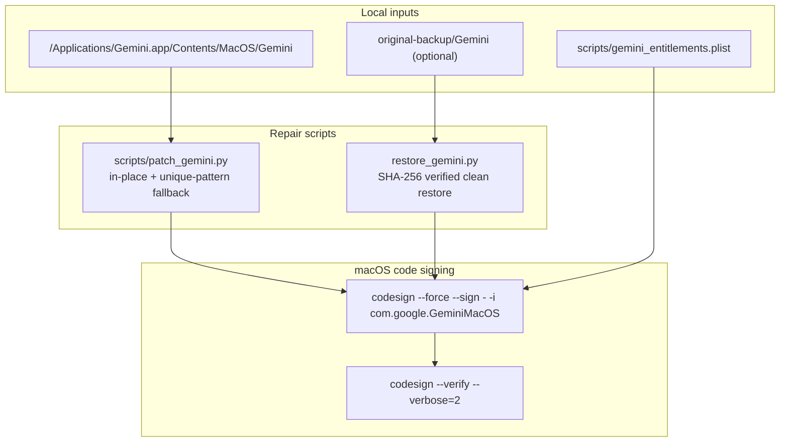

<h1 align="center">Gemini.app Repair Kit (macOS)</h1>

<p align="center">
  <strong>Startup deadlock fix · UI icon restoration · navbar pill alignment · account-switch hang fix</strong>
</p>

<p align="center">
  Community ARM64 binary patches for <code>/Applications/Gemini.app</code> (<code>com.google.GeminiMacOS</code>, tested on <code>1.147.5.1526</code>, <code>1.147.6.1557</code>, and <code>1.150.3.1601</code> on macOS 15.8.3) that resolve launch freezes, missing icons and avatars, clipped titlebar pills, and account-switching deadlocks.
</p>

<p align="center">
  <a href="#what-is-geminiapp-repair-kit">Introduction</a> ·
  <a href="#why-this-kit">Why This Kit</a> ·
  <a href="#included-patches">Included Patches</a> ·
  <a href="#quick-start">Quick Start</a> ·
  <a href="#patch-architecture">Architecture</a> ·
  <a href="#signing-and-keychain">Signing &amp; Keychain</a> ·
  <a href="#verification">Verification</a> ·
  <a href="#license">License</a>
</p>

<p align="center">
  <a href="https://github.com/jnvhr/gemini-repair-kit"></a>
  
  
  
  
  
  <a href="LICENSE"></a>
</p>

---

## What is Gemini.app Repair Kit?

Gemini.app Repair Kit is an **unofficial community patch kit for `/Applications/Gemini.app`** on Apple Silicon Macs running macOS `< 26.2` (verified on macOS 15.8.3 with `Gemini.app` `1.147.5.1526`, `1.147.6.1557`, and `1.150.3.1601`). It applies seven targeted ARM64 machine-code patches to fix startup and account-switching deadlocks as well as SwiftUI/AppKit rendering regressions, then re-signs the app bundle ad-hoc with its original non-sandboxed entitlements.

**Gemini.app Repair Kit = 7 surgical ARM64 patches + pattern-match fallback + ad-hoc `codesign` + SHA-256-verified restore.**

> **Disclaimer:** This is an unofficial community patch kit. It modifies your local `/Applications/Gemini.app` binary and re-signs it ad-hoc. No proprietary Google binaries are included in this repository.

- 🔒 **Startup Deadlock Fix (`P1`)**: skips `SpellCheckerWarmUpTask` so background initialization does not AB-BA deadlock against main-thread `OmnichatWindow` startup.
- 🎨 **UI Icon & Avatar Restoration (`P2`)**: disables `CALayerFlippedContentsWorkaround.install()`, preventing erroneous `[layer setNeedsDisplay]` calls on `SwiftUI.ImageLayer` instances on macOS `< 26.2`.
- 📐 **Top Navbar Pill Geometry (`P3a`–`P3d`)**: clamps toolbar font and icon scales to `1.0`, forces pill height to `36.0pt`, and sets top padding to `6.0pt` so titlebar pills render without vertical clipping.
- 🔄 **Account-Switch Deadlock Fix (`P4`)**: eliminates a 3-way lock inversion in `ClearcutServiceImpl.shouldSendCrashesAndUsageData` triggered by a lazy `NSUserDefaults.setBool(true, ...)` write.
- 🔍 **Safe & Reversible Workflow**: `scripts/patch_gemini.py` backs up your installed executable before patching and supports unique-pattern fallback; `restore_gemini.py` validates against `ORIG_SHA256` before restoring and patching.
- 📜 **Open Source**: MIT-licensed Python scripts with zero third-party dependencies.

---

## Why This Kit?

Running `Gemini.app` `1.147.5.1526` on macOS Sequoia (`15.8.3`) triggers multiple thread-lock inversions and macOS-version-gated UI layout bugs. This kit resolves all four locally without disabling System Integrity Protection (SIP):

| Behavior | Stock `Gemini.app` (`1.147.5.1526` on macOS 15.8.3) | **Patched `Gemini.app` (Repair Kit)** |
|---|---|---|
| Launch / startup reliability | ❌ AB-BA deadlock in `SpellCheckerWarmUpTask` | **✅ Clean startup (`P1`)** |
| Toolbar icons & profile avatar | ❌ Wiped by `CALayerFlippedContentsWorkaround` | **✅ Rendered normally (`P2`)** |
| Top navbar pill alignment | ❌ Vertically clipped / misaligned | **✅ `1.0` scale, `36.0pt` height, `6.0pt` top pad (`P3a`–`P3d`)** |
| Switching or adding accounts | ❌ 3-way deadlock in Clearcut `NSUserDefaults` write | **✅ Instant account switch (`P4`)** |
| Code signature & entitlements | Apple-signed (`com.google.GeminiMacOS`) | **✅ Ad-hoc signed with matching entitlements** |
| Backup & rollback | Manual reinstall required | **✅ `Gemini.backup` + `restore_gemini.py`** |

The repair flow:


_Text fallback: quit `Gemini.app` → back up the original Mach-O binary → apply all 7 ARM64 byte patches (exact offset or unique pattern match) → ad-hoc re-sign with `gemini_entitlements.plist` → verify the code signature and patched bytes._

---

## Included Patches

| Patch | `1.147.5.1526` | `1.147.6.1557` | `1.150.3.1601` | Status | Root Cause & Fix |
|---|---|---|---|---|---|
| **P1** | `0x034F68E0` | `0x0354D5A0` | `0x03961930` | ✅ Applied | Startup AB-BA deadlock: branches past `SpellCheckerWarmUpTask` during main-thread `OmnichatWindow` init (`b +0x1c`) |
| **P2** | `0x034CEBF4` | `0x035258B4` | `0x039320FC` | ✅ Applied | Missing icons & avatar: early `ret` from `CALayerFlippedContentsWorkaround.install()` so `SwiftUI.ImageLayer` contents are preserved on macOS `< 26.2` |
| **P3a** | `0x0568B88C` | `0x056E2760` | `0x06224BAC` | ✅ Applied | Navbar text clipping: clamps `clampedToolbarFontScale` to `<= 1.0` |
| **P3b** | `0x0568B8A8` | `0x056E277C` | `0x06224BC8` | ✅ Applied | Navbar icon clipping: clamps `iconButtonSize` scale to `<= 1.0` |
| **P3c** | `0x0568B8C8` | `0x056E279C` | `0x06224BE8` | ✅ Applied | Navbar pill height: sets `toolbarPillHeight` to `36.0pt` |
| **P3d** | `0x0568B900` | `0x056E27D4` | `0x06224C20` | ✅ Applied | Navbar pill vertical alignment: sets `toolbarPillTopPadding` to `6.0pt` |
| **P4** | `0x027B652C` | `0x0280D7EC` | `0x02B8B058` | ✅ Applied | Account switch / add-account freeze: skips lazy `NSUserDefaults.setBool(true, ...)` inside `ClearcutServiceImpl.shouldSendCrashesAndUsageData` (`b +0x60`) |

---

## Quick Start

### Prerequisites

- **macOS on Apple Silicon (ARM64)** (tested on macOS `15.8.3`)
- **`/Applications/Gemini.app`** installed (exact offsets for `1.147.5.1526`, `1.147.6.1557`, and `1.150.3.1601`, plus pattern fallback)
- **Python** `>= 3.8` for [`scripts/patch_gemini.py`](scripts/patch_gemini.py), or `>= 3.11` for [`restore_gemini.py`](restore_gemini.py) (uses `hashlib.file_digest`)
- **Xcode Command Line Tools** (`codesign` binary)

### Patch the installed app

```bash
git clone https://github.com/jnvhr/gemini-repair-kit.git
cd gemini-repair-kit
python3 scripts/patch_gemini.py
```

[`scripts/patch_gemini.py`](scripts/patch_gemini.py) automatically:
1. Detects the installed `CFBundleShortVersionString` from `Info.plist` and quits `Gemini` if running (`killall Gemini`).
2. Copies `/Applications/Gemini.app/Contents/MacOS/Gemini` to `scripts/Gemini.<version>.backup` (ignored by git) if no backup exists yet.
3. Applies all 7 ARM64 byte patches (falling back to a unique byte-pattern search if offsets shifted slightly in a minor update).
4. Re-signs `/Applications/Gemini.app` ad-hoc using [`scripts/gemini_entitlements.plist`](scripts/gemini_entitlements.plist) and verifies with `codesign --verify --verbose=2`.

### Restore & patch from pristine backup (`1.147.5.1526`)

If you keep a pristine `1.147.5.1526` executable at `original-backup/Gemini` (SHA-256 `1015c0c3c063f982f8ec5b178b20605dc0c58d5ccab9b730a30748f6fc39ec05`):

```bash
# Verify installed app has all 7 patches + valid signature
python3 restore_gemini.py --check

# Validate backup hash and print patch readiness without modifying disk
python3 restore_gemini.py --dry-run

# Quit Gemini first, then restore original binary + apply all 7 patches + re-sign
python3 restore_gemini.py
```

---

## Patch Architecture



_Text fallback: `scripts/patch_gemini.py` patches the installed binary in place (with unique-pattern fallback) after saving `scripts/Gemini.backup`, while `restore_gemini.py` restores from a SHA-256-verified `original-backup/Gemini` before patching; both re-sign `/Applications/Gemini.app` ad-hoc with `scripts/gemini_entitlements.plist` and verify the signature._

### Patch Specification

| ID | Target Symbol / Area | `1.147.5.1526` | `1.147.6.1557` | `1.150.3.1601` | Patched Hex |
|---|---|---|---|---|---|
| `P1` | `SpellCheckerWarmUpTask` branch | `0x034F68E0` | `0x0354D5A0` | `0x03961930` | `07000014` |
| `P2` | `CALayerFlippedContentsWorkaround.install` | `0x034CEBF4` | `0x035258B4` | `0x039320FC` | `c0035fd6` |
| `P3a` | `clampedToolbarFontScale` | `0x0568B88C` | `0x056E2760` | `0x06224BAC` | `01106e1e0020611e20cc601ec0035fd6` |
| `P3b` | `iconButtonSize` | `0x0568B8A8` | `0x056E277C` | `0x06224BC8` | `01106e1e1f2003d51f2003d51f2003d5` |
| `P3c` | `toolbarPillHeight` | `0x0568B8C8` | `0x056E279C` | `0x06224BE8` | `4808e8d20001679ec0035fd6` |
| `P3d` | `toolbarPillTopPadding` | `0x0568B900` | `0x056E27D4` | `0x06224C20` | `0010631ec0035fd6` |
| `P4` | `ClearcutServiceImpl.shouldSendCrashesAndUsageData` | `0x027B652C` | `0x0280D7EC` | `0x02B8B058` | `18000014` |

### Repository Contents

| Path | Responsibility |
|---|---|
| [`scripts/patch_gemini.py`](scripts/patch_gemini.py) | Unified in-place patcher with automatic backup, unique-pattern fallback, and ad-hoc `codesign` |
| [`scripts/gemini_entitlements.plist`](scripts/gemini_entitlements.plist) | Entitlements used during re-signing (`com.apple.security.app-sandbox` disabled to match stock app) |
| [`scripts/apply_ui_patches.py`](scripts/apply_ui_patches.py) | Standalone reference script for applying `P2` and `P3a`–`P3d` UI patches |
| [`scripts/update_patch3d.py`](scripts/update_patch3d.py) | Reference incremental script for updating `P3d` (`toolbarPillTopPadding`) |
| [`restore_gemini.py`](restore_gemini.py) | Exact-version (`1.147.5.1526`) restore, `--check`, and `--dry-run` tool using `original-backup/Gemini` |
| [`SHA256SUMS`](SHA256SUMS) | SHA-256 integrity manifest for tracked files and reference backup hashes |
| [`LICENSE`](LICENSE) | MIT license text |

---

## Signing & Keychain

- **Ad-hoc code signing**: patching invalidates Google's original signature, so both scripts re-sign `/Applications/Gemini.app` ad-hoc with `-i com.google.GeminiMacOS` and [`scripts/gemini_entitlements.plist`](scripts/gemini_entitlements.plist).
- **macOS Keychain prompts**: because ad-hoc re-signing changes the executable's `cdhash`, macOS will prompt for your login Keychain password the first time you launch or switch into each Google account (`DeviceAccountUUIDStore`, `DeviceAccountKeyStore`, `OnboardingCohort.PROD`). Click **Always Allow** once per account and macOS will remember the patched binary's `cdhash` on subsequent switches.
- **Background auto-updates (`GeminiAppLauncher`)**: `GeminiAppLauncher.app` runs an Omaha background updater (`OmahaBackgroundInstaller`) that silently swaps `/Applications/Gemini.app` when Google pushes a new version and the main app is closed. Re-run `python3 scripts/patch_gemini.py` whenever a new update lands.
- **No binary redistribution**: [`original-backup/`](.gitignore) and `*.backup` files are excluded via `.gitignore` so proprietary Google binaries are never committed.

---

## Verification

```bash
# Check all 7 patched offsets and verify codesign on /Applications/Gemini.app
python3 restore_gemini.py --check

# Verify bundle signature directly
codesign --verify --verbose=2 /Applications/Gemini.app

# Verify tracked repository file checksums
shasum -a 256 -c SHA256SUMS
```

---

## License

Gemini.app Repair Kit is licensed under the [MIT License](LICENSE).
